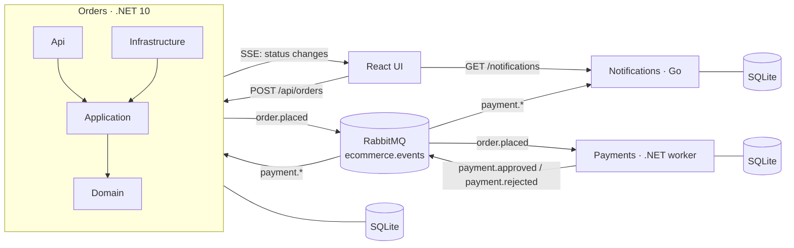

# Orders Microservices

[](https://github.com/edybackend/orders-microservices/actions/workflows/ci.yml)
[Leia em português](README.pt-BR.md)

An event-driven order flow split into three services that talk only through RabbitMQ:
**Orders** (.NET, Clean Architecture + CQRS), **Payments** (.NET worker) and **Notifications** (Go).
A React UI shows each order moving from *Pending* to *Paid* or *Rejected* in real time.

## Quick start

Requirements: Docker.

```bash
docker compose up --build
```

| What | Where |
|---|---|
| Web UI + Orders API | http://localhost:8080 |
| OpenAPI document | http://localhost:8080/openapi/v1.json |
| Notifications API (Go) | http://localhost:8081/notifications |
| RabbitMQ management | http://localhost:15672 (guest / guest) |

Click **Approved sample** or **Rejected sample (> $5,000)** and place the order. The status changes about two seconds later, and the notification written by the Go service appears under the order.

## Architecture



Each service owns its database (embedded SQLite) and shares nothing but the event contracts in [`contracts/events.md`](contracts/events.md).

## Tech stack

| Area | Choice |
|---|---|
| Orders | .NET 10, minimal APIs, EF Core (writes), Dapper (reads), Server-Sent Events, OpenAPI |
| Payments | .NET 10 Worker Service, Dapper |
| Notifications | Go, `net/http`, `amqp091-go`, `modernc.org/sqlite` (no CGO) |
| Messaging | RabbitMQ topic exchange, publisher confirms, manual acks, dead-letter queues |
| Front-end | React 19, TypeScript, Vite |
| Quality | xUnit v3, NetArchTest, `go test -race`, golangci-lint, oxlint, Roslyn analyzers (warnings as errors) |
| Delivery | Multi-stage non-root images, Docker Compose, Kubernetes manifests (kustomize), GitHub Actions |

## Project structure

```
src/
  BuildingBlocks/          event contracts + RabbitMQ publisher/consumer shared by the .NET services
  Orders/                  Domain · Application · Infrastructure · Api (Clean Architecture)
  Payments/Payments.Worker single project: Domain / Application / Infrastructure folders
  notifications/           Go service: cmd/ + internal/
web/                       React UI (built into the Orders image)
tests/                     unit, integration, architecture tests
contracts/                 event documentation shared by .NET and Go
deploy/k8s/                Kubernetes manifests
specs/                     feature specs (spec-first workflow)
```

## Design decisions

- **Clean Architecture only where it pays off.** Orders has real business rules, so it has four layers and the dependency rule is enforced by architecture tests. Payments is one project with folders.
- **CQRS with two tools.** EF Core writes through the aggregate; Dapper reads flat DTOs with plain SQL.
- **Idempotent consumers.** A processed-message table in Orders, a unique `order_id` in Payments and a unique `event_id` in Notifications make redelivery harmless.
- **Ack after commit, dead-letter on failure.** A poison message goes to `<queue>.dlq` instead of blocking the queue.
- **Go where it fits.** A small, I/O-bound consumer with a tiny static binary on a distroless image.

## Tests

```bash
dotnet test                                   # unit, integration (real API + SQLite) and architecture tests
cd src/notifications && go test -race ./...   # Go tests
cd web && npm ci && npm run lint && npm run build
```

No broker is needed: integration tests replace the publisher and do not start the consumers.

## Kubernetes (Docker Desktop)

```bash
docker compose build                      # images are shared with the local cluster
kubectl apply -k deploy/k8s
kubectl -n orders-demo port-forward svc/orders-api 8080:8080
kubectl -n orders-demo port-forward svc/notifications 8081:8081
```

## Known trade-offs

- **Dual write.** Orders saves the order and then publishes `OrderPlaced`. If the broker fails in between, the order stays *Pending*. The Outbox pattern closes this gap; it is left out to keep this repository focused.
- **Single API instance.** SQLite files and the in-memory SSE broadcaster assume one replica. Scaling out would mean a server database and a backplane (for example Redis pub/sub).
- **Demo credentials.** RabbitMQ uses the default `guest` user. A real deployment would read them from a secret manager.

## Working with an AI agent

I build with an AI coding agent, but inside rails I set up first. [`CLAUDE.md`](CLAUDE.md) holds the rules of this codebase (service boundaries, CQRS, idempotent consumers), and the hooks in [`.claude/`](.claude) refuse edits to secrets and generated files and run the same gates as CI before any task counts as done. Features start as a spec in [`specs/`](specs).

## License

[MIT](LICENSE)
